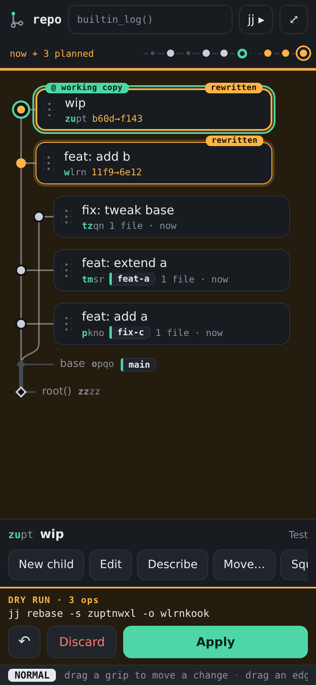
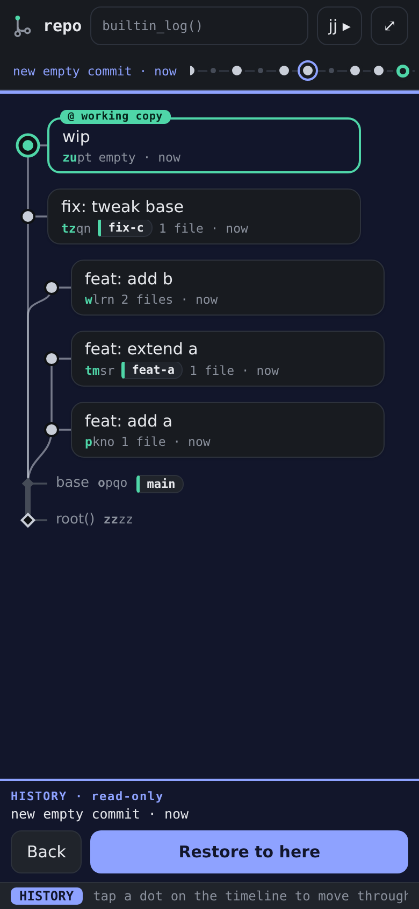

# jj-graph

A touch-first web UI for [Jujutsu](https://jj-vcs.dev) built around the
revision graph. Drag changes, edges and bookmarks around the DAG to try
operations as a dry run, then commit to the result with one button.

 

## It draws jj's model, not Git's

- **Changes are cards, and the change id leads.** A change you can still
  rewrite is a card with a grip. When a dry run rewrites one, the card stays
  put under the same id and shows only the commit underneath changing
  (`a3d2→55e5`). **Evolution** lists every version a change has had.
- **Colour means state, never branch.** jj has no current branch, so nothing
  is coloured by lane. The working copy, empty changes, conflicts and
  previewed rewrites each have their own look.
- **The working copy is a change.** `@` is a card like the others, with a
  live file count. There is no staging area to show.
- **Immutable history is bedrock.** Commits you cannot rewrite collapse to
  one quiet line each on a thick spine; everything above it is yours to move.
- **Bookmarks are tags hung on changes.** They do not follow you around, and
  you drag them like any other object.
- **Conflicts do not block.** A conflicted change is a hatched card that you
  can keep moving, and the plan says how many there are without stopping you.
- **Descendants follow on their own.** Changes that jj rebased because
  something beneath them moved are marked `auto-rebased`, apart from the ones
  you touched.
- **The operation log is a timeline.** The strip under the title bar is every
  state the repository has been in. Tap a dot to look at the graph as it was,
  and **Restore to here** to preview going back. A dry run's steps continue
  the same line past "now", because they are operations that have not
  happened yet.

## Run it

Needs `jj` 0.47 or newer and Node 20 or newer. There are no dependencies.

```sh
node server.mjs [REPO] [--port 7777] [--host 127.0.0.1]
```

To use it from a phone, bind an address the phone can reach, such as
`--host 0.0.0.0`. The printed URL then carries a token, and the API refuses
requests without it. Anyone holding that URL can rewrite the repository, so
keep it to a network you trust.

## Gestures

| Do this | To get |
| --- | --- |
| Drag a card's grip (or its dot) onto another change | A menu: move with descendants, move alone, move the branch, insert after or before, squash into, add as a parent, duplicate |
| Drag a grip onto an edge | Insert the change between the edge's two ends |
| Drag an edge onto a change | Reparent: the edge's child swaps that parent for the drop target |
| Drag a bookmark onto a change | Move the bookmark |
| Tap a change | Its actions: new child, edit, describe, move, squash, duplicate, bookmark, diff, evolution, abandon |
| Tap an edge | Insert a new change there, or remove that parent from a merge |
| Tap a bookmark | Move or delete it |
| Tap a dot on the timeline | Look at that operation, or jump to that step of the dry run |
| Drag a card or empty space, pinch, or scroll | Pan and zoom |

Every menu entry shows the exact `jj` command it stands for. **Move…** on a
change is the same as dragging, done with taps: pick the change, then tap its
destination. The `jj ▸` button dry-runs any command you type.

With a keyboard, the status line at the bottom shows the current mode
(`NORMAL`, `PICK`, `DRAG`, `HISTORY` or `INPUT`) and the keys that work in
it. `[` and `]` step through the timeline.

## How the dry run works

Nothing you do in the graph touches the repository until you press **Apply**.

Each step runs as `jj --at-op <previous step> --no-integrate-operation <command>`.
jj performs the command for real, conflicts included, and writes an operation
that it leaves out of the operation log. The graph then shows the repository
as of that operation. The working copy, the Git refs of a colocated
repository, and `jj log` in your terminal all stay as they were.

- **Undo** and **redo** step back and forth through the plan.
- **Discard** forgets the plan. Its operations are left unreferenced for
  `jj util gc` to collect.
- **Apply** runs `jj op integrate` on the last step and then
  `jj workspace update-stale`, and offers to undo the whole apply with
  `jj op restore`.

If the repository changes while a plan is open, for example because you
edited a file, the plan is replayed on top of the new state, so applying it
never leaves divergent changes. If a step no longer applies, the plan is
marked out of date and Apply is disabled until you undo that step or discard.

## Limits

- Commands with effects outside the repository (`git push`, `git fetch`) and
  interactive ones (`split`, `squash -i`, `resolve`) cannot be dry-run and are
  refused.
- The graph draws at most 400 revisions of the revset, and the timeline the
  newest 14 operations.
- A typed command that names a change created earlier in the same plan by a
  shortened id may fail to replay after the repository changes. Commands
  built by dragging use full ids and do not have this problem.

## jjr framework

`jj-graph` ships with **jjr** (`jjr/index.mjs` + TypeScript declarations in
`jjr/index.d.ts`), a zero-dependency framework layer integrated directly with
the dry-run engine:

- **Identity–state types (`jjr/types.mjs`)**: runtime and TypeScript branded
  separation between `ChangeId` (reverse-hex `k–z`), `CommitId` (hex `0–9a–f`),
  `OpId`, and `BookmarkName`.
- **Guardrail pipeline (`jjr/guardrails.mjs`)**: six pre-flight rules
  (Immutable Bedrock, Divergence Guard, Megamerge Fence, Publishing Gate,
  Colocated Single-Writer Guard, and Workspace Discipline) that gate dry-runs,
  pushes, Git interop, and workspace creation.
- **TypeSafe Jev System-One decisions (`jjr/jev.mjs`)**: wire-compatible
  `POST /v1/systemone` client (`choice`, `score`, `noul`) with calibrated
  offline fallback. Powers single-pass change triage, the Two-Part Dependency
  Gate (pausing for human confirmation in the ambiguous probability band),
  scratchpad/blast-radius risk advisories, dual time-axis recovery routing, and
  ambiguous `jj absorb` hunk routing. Set `TYPESAFE_API_KEY` to enable live
  Jev inference.
- **Light LLM narrator (`jjr/narrator.mjs`)**: System-Two prose layer strictly
  for naming changes, bookmark slugs, and two-sentence diagnostic summaries
  (set `JJR_LLM_API_KEY` or `OPENAI_API_KEY`, with deterministic fallback).
- **SDLC patterns & portable UI (`jjr/patterns.mjs`, `jjr/ui/`)**: dry-run
  recipes (*Tidy First?*, TDD red-test verification, Branch by Abstraction,
  local megamerges, post-merge convergence) and render-agnostic ViewModels that
  port 1:1 to TUI (`jjr/ui/tui.mjs`) or GUI (`jjr/ui/gui.mjs`).

Open `/docs` while `server.mjs` is running (or open `docs/index.html` directly)
for the interactive reference documentation.

## Develop

```sh
npm test        # 23 unit + integration tests against throwaway jj repos
npm run eval    # deterministic jjr eval harness (evals/harness.mjs)
```

The tests and eval harness build throwaway repositories with `jj` and cover the
layout, dry-run plan, replay, apply, undo, history, evolution, jjr guardrails,
TypeSafe Jev workflows, and portable UI ViewModels.

