# Design Snapshots

Visual snapshots of **jj-graph** across its main UI states, viewports, and themes to support iterative design feedback.

Open [`index.html`](index.html) in a browser for the filterable side-by-side gallery with full-size zoom and copyable snapshot IDs, or inspect individual PNGs below.

## Regenerating after design edits

```sh
npm run snapshots
# or:
node docs/snapshots/capture.mjs
```

`capture.mjs` builds a deterministic throwaway `jj` fixture repository, runs the real `jj-graph` backend for `/api/*`, serves `public/` directly from disk (so CSS/HTML/JS changes show up immediately without recompiling Rust), renders the OpenCode plugin panels directly from `.opencode/plugins/jj-graph/model.ts` and `gui.css`, and captures `@2x` PNGs via headless Chrome.

Environment overrides:
- `JJ_GRAPH_BIN` — path to `jj-graph` binary (defaults to `target/debug/jj-graph`, `target/release/jj-graph`, or `jj-graph` on `PATH`)
- `CHROME_BIN` — path to Chrome/Chromium binary (defaults to `google-chrome`, `chromium`, or `chromium-browser`)

## Snapshot Index

### Web UI — Mobile (`390×844` @2x)

| ID | File | State covered |
| --- | --- | --- |
| `web-mobile-dark-live` | [`web-mobile-dark-live.png`](web-mobile-dark-live.png) | Baseline live graph (dark): immutable bedrock, mutable cards, `@` working copy, bookmarks, empty dashed card, timeline, `jjr` badge |
| `web-mobile-light-live` | [`web-mobile-light-live.png`](web-mobile-light-live.png) | Baseline live graph (light): warm paper palette, card contrast, badge legibility |
| `web-mobile-dark-inspector` | [`web-mobile-dark-inspector.png`](web-mobile-dark-inspector.png) | Selected change with bottom Inspector and action strip |
| `web-mobile-dark-dry-run` | [`web-mobile-dark-dry-run.png`](web-mobile-dark-dry-run.png) | Active dry run: amber tint, `rewritten` (`xxxx→yyyy`) & `auto-rebased` tabs, extended timeline, Undo/Discard/Apply plan bar |
| `web-mobile-dark-conflict` | [`web-mobile-dark-conflict.png`](web-mobile-dark-conflict.png) | Non-blocking conflict in dry run: red hatched card, `conflict` chip, plan bar warning |
| `web-mobile-dark-history` | [`web-mobile-dark-history.png`](web-mobile-dark-history.png) | Operation-log time-travel: indigo read-only wash, grips hidden, `Restore to here` |
| `web-mobile-dark-sheet-menu` | [`web-mobile-dark-sheet-menu.png`](web-mobile-dark-sheet-menu.png) | Drop action bottom sheet with `jj` command previews |
| `web-mobile-dark-sheet-jjr` | [`web-mobile-dark-sheet-jjr.png`](web-mobile-dark-sheet-jjr.png) | `jjr` Framework bottom sheet: diagnostics, triage, naming, and verify/publish actions |

<p>
  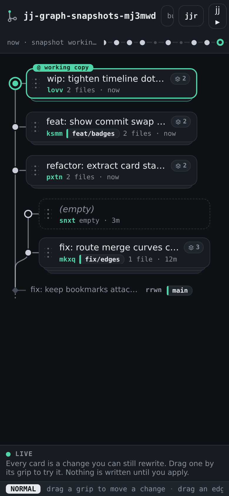
  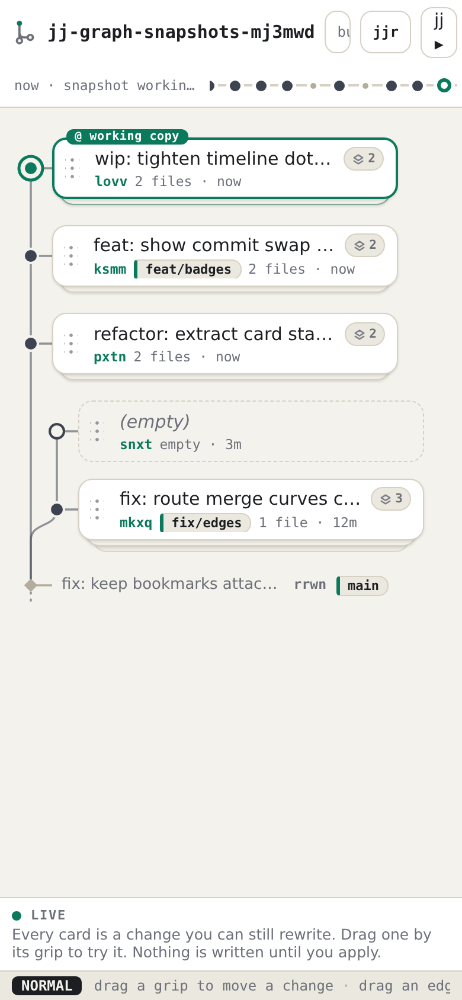
  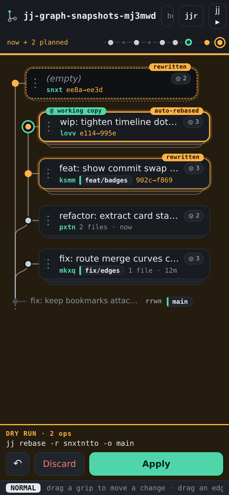
  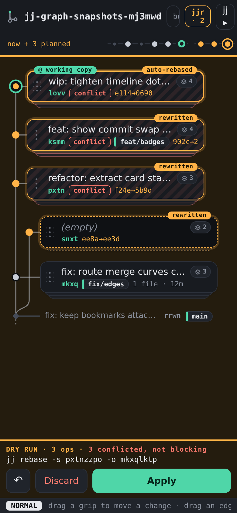
</p>
<p>
  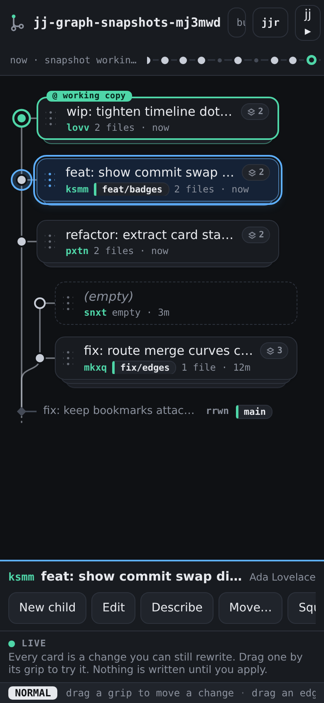
  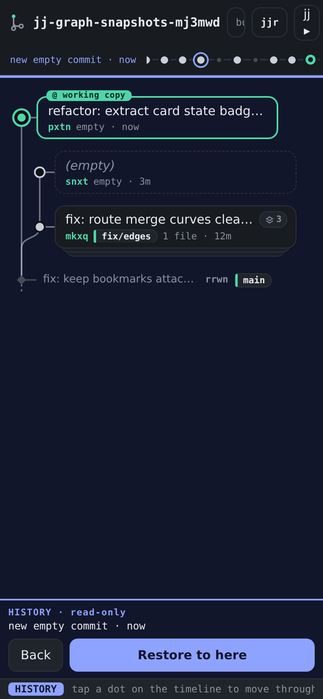
  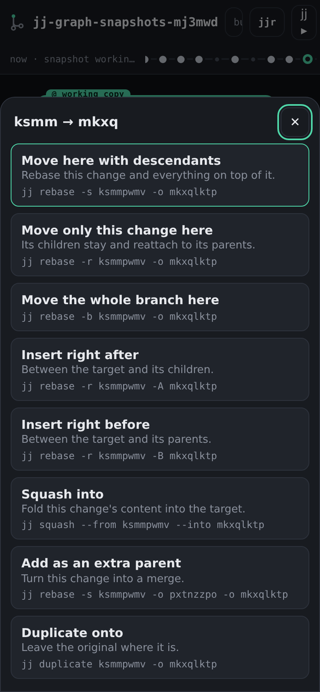
  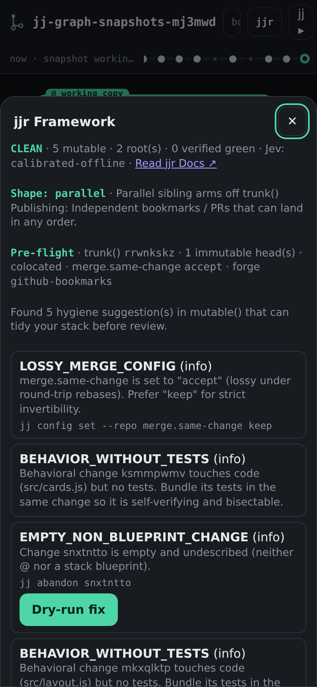
</p>

### Web UI — Desktop (`1280×800` @2x)

| ID | File | State covered |
| --- | --- | --- |
| `web-desktop-dark-dry-run` | [`web-desktop-dark-dry-run.png`](web-desktop-dark-dry-run.png) | Desktop dry run + Inspector + keyboard hints |
| `web-desktop-light-live` | [`web-desktop-light-live.png`](web-desktop-light-live.png) | Desktop live graph + Inspector in light theme |
| `web-desktop-dark-diff` | [`web-desktop-dark-diff.png`](web-desktop-dark-diff.png) | Centered wide diff modal (`dialog#sheet.wide`) |

<p>
  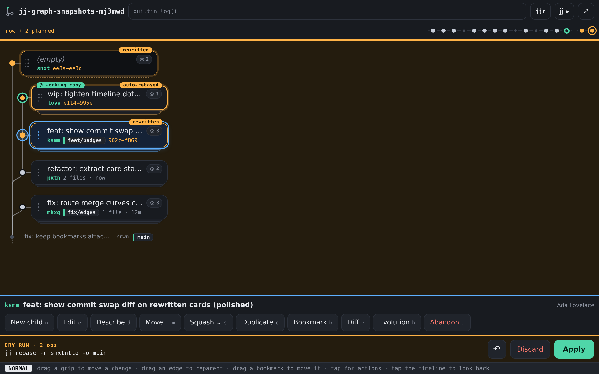
  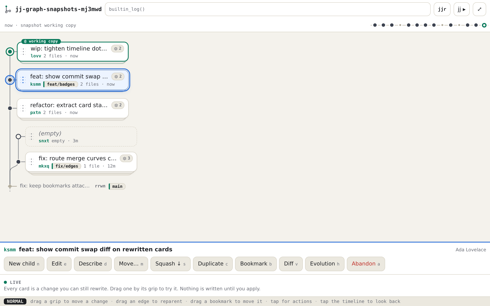
  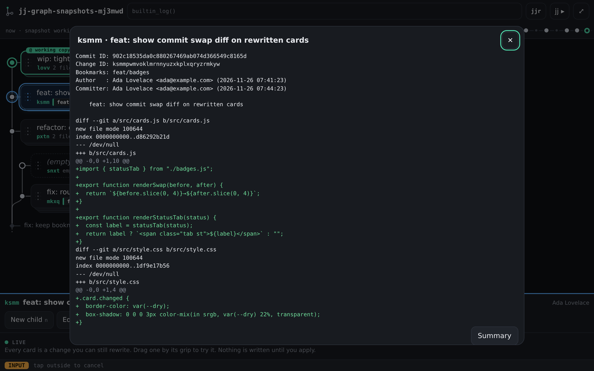
</p>

### OpenCode Plugin — Desktop GUI & TUI

| ID | File | State covered |
| --- | --- | --- |
| `opencode-gui-dark` | [`opencode-gui-dark.png`](opencode-gui-dark.png) | OpenCode Desktop panel (`gui.tsx` + `gui.css`) in dark theme: Graph, Plan, jjr, and DETAIL views |
| `opencode-gui-light` | [`opencode-gui-light.png`](opencode-gui-light.png) | OpenCode Desktop panel in light theme |
| `opencode-tui-dark` | [`opencode-tui-dark.png`](opencode-tui-dark.png) | OpenCode TUI (`tui.tsx`): sidebar summary, home footer item, jjr tab, and docked Graph panel |

<p>
  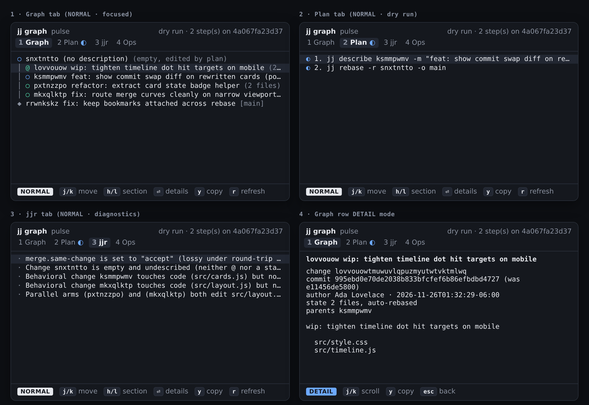
  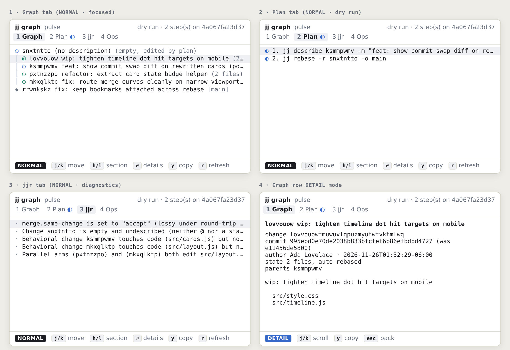
  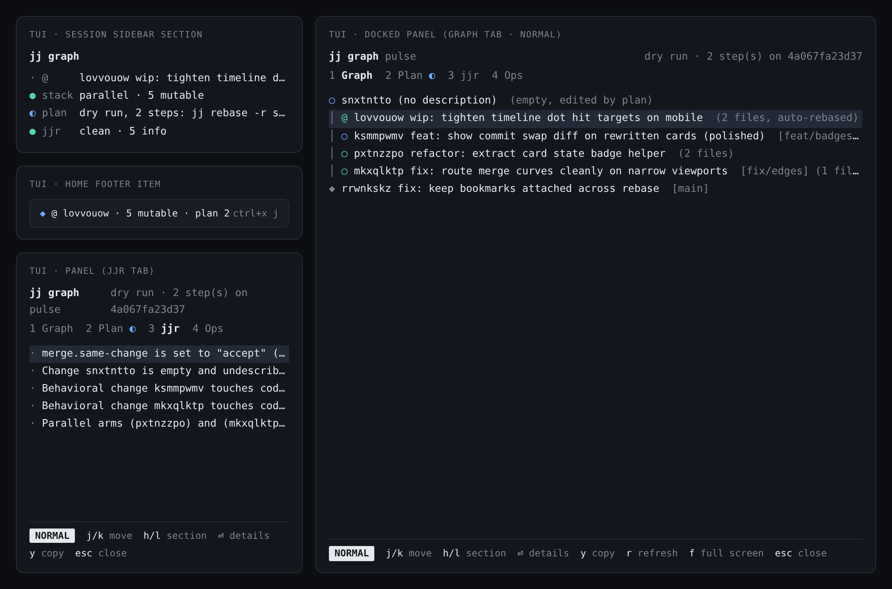
</p>
